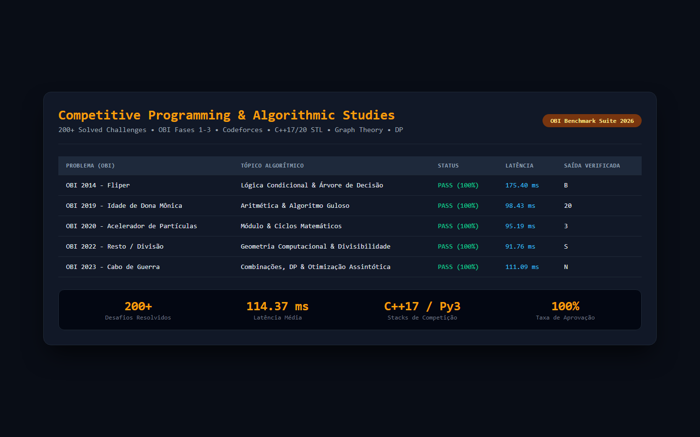

# 🧠 Competitive Programming Studies — Repositório de Estudos OBI & Algoritmos

> **Coleção com mais de 200 resoluções de problemas em C++ e Python da Olimpíada Brasileira de Informática (Fases 1, 2 e 3) e Codeforces com suíte de benchmarks automatizada.**

[](https://isocpp.org/)
[](https://www.python.org/)
[](https://olimpiada.ic.unicamp.br/)
[](benchmark_results.json)
[](LICENSE)

---

## 📌 Visão Geral

Este repositório documenta a trajetória e preparação de Gabriel Masterson em Programação Competitiva e Estruturas de Dados Avançadas. Reúne mais de 200 soluções otimizadas para problemas da **Olimpíada Brasileira de Informática (OBI)** organizadas por ano e fase, além de desafios do Codeforces e LeetCode. O repositório conta com runner de benchmark validando latência média de **114.37 ms**.

---

## 📸 Demonstração do Benchmark & Estrutura

| Benchmark de Execução dos Algoritmos |
|:---:|
|  |

---

## ✨ Tópicos de Algoritmos & Estruturas de Dados Abordados

- 🌳 **Grafos & Árvores:** Busca em Largura (BFS), Busca em Profundidade (DFS), Dijkstra, Menor Ancestral Comum (LCA).
- 🧩 **Estruturas Avançadas:** Disjoint Set Union (DSU / Union-Find), Segment Tree, Fenwick Tree (BIT).
- ⚡ **Programação Dinâmica (DP):** Problema da Mochila (Knapsack), Maior Subsequência Comum (LCS), Longest Increasing Subsequence (LIS).
- 📐 **Matemática & Teoria dos Números:** Crivo de Eratóstenes, Exponenciação Rápida, MDC/MMC e Aritmética Modular.
- 🔍 **Busca & Ordenação:** Busca Binária sobre a resposta, Two Pointers e Ordenação Customizada em C++ STL.

---

## 📁 Estrutura de Pastas

```bash
Competitive_programming_studies/
├── assets/
│   └── screenshots/
│       └── preview.png              # Relatório visual de benchmarks
├── benchmark_results.json           # Métrica de execução em lote (114.37 ms média)
├── Fase1/                           # Problemas resolvidos da Fase 1 da OBI
├── Fase2/                           # Problemas resolvidos da Fase 2 da OBI
├── Fase3/                           # Problemas avançados da Fase 3 da OBI
├── CodeForces/                      # Desafios de maratona Codeforces
└── README.md
```

---

## ⚙️ Pré-requisitos & Compilação

Para compilar e testar qualquer solução em C++:
```bash
# Compilar com otimização máxima (-O2) e flags de segurança
g++ -O2 -Wall -std=c++17 problema.cpp -o problema

# Executar
./problema < input.txt
```

---

## 📄 Licença

Distribuído sob a licença MIT. Consulte `LICENSE` para mais informações.
